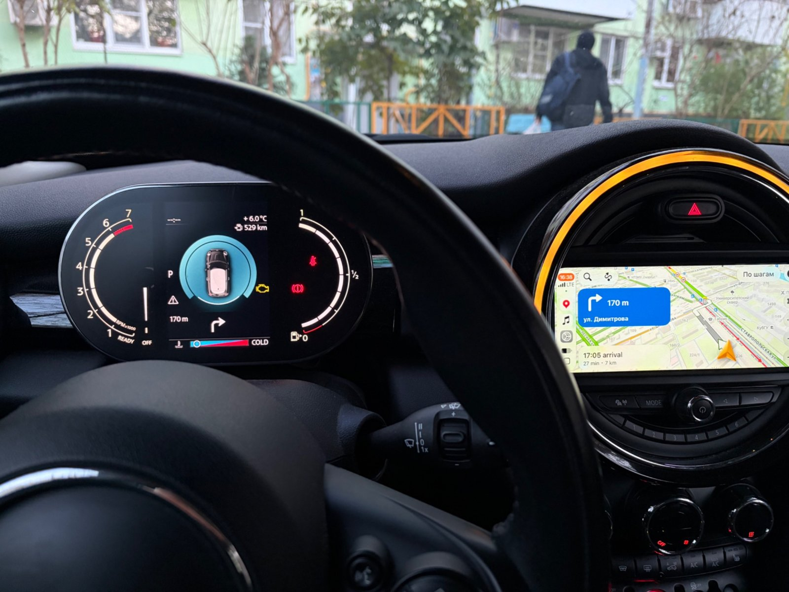
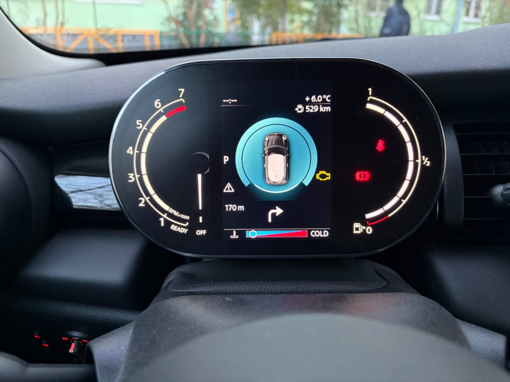
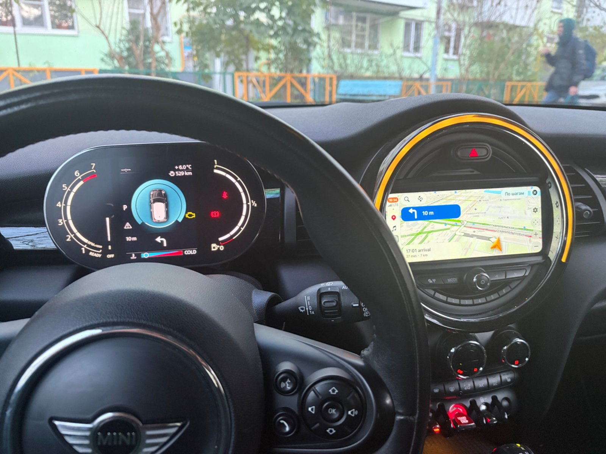

# MINI F5x digital cluster — CarPlay route-guidance research

This repository is a **research workspace** for the CarPlay route-guidance path to the stock MINI F5x digital instrument panel. The project uses the family name **MINI_F5X** and must not be confused with the separate BMW F-series **6WB** layout implemented by the upstream project.

The user confirms that MINI F54, F55, F56, F57 and F60 share the same physical instrument panel. This is a panel-family rule, not proof that all five chassis have identical HMI software, firmware, coding, options, terminal instances or MOST transport behavior.

This repository is based on [st1ng/nbtevo-carplay-advanced](https://github.com/st1ng/nbtevo-carplay-advanced). It is not intended to become a separate product that drops upstream capabilities. Its purpose is to develop, test and document narrowly scoped changes that can be proposed as pull requests to the parent repository.

> **Research workspace, not a ready-to-install product.** The code, installer and prebuilt payload are inherited from upstream and may support multiple vehicle families, cluster types and HUD configurations. Their presence is intentional. A research focus on MINI_F5X does not mean that other support paths have been removed, disabled, validated or superseded.

## Current technical result

The most important new result is a **vehicle-observed F56 CarPlay route-guidance output with DSI transmissionType 4**:

- The historical F56 log summary records HUD transmissionType 4 and HUDTerminal 82/00.
- Maneuver distances of 160 m, 170 m and 10 m were recorded in the vehicle run.
- The user photo below shows the 170 m right-turn prompt on the center CarPlay display and the stock instrument cluster at the same time.
- A supplementary photo below shows the 10 m left-turn prompt.

This proves visible guidance was observed in that F56 session. It does **not** yet prove a positive C04 ImageGetSize response, buffer dimensions, a controlled TX=0 comparison, complete native handle setup, or compatibility with every MINI_F5X HMI build.

| Instrument cluster detail | Left turn in 10 m |
| --- | --- |
|  |  |

Photographs supplied by the project owner from the actual MINI F56 test vehicle. All three photographs retain their full framing and visible street names; the 1600 × 1200 web copies have EXIF metadata removed.

See the [photo provenance and SHA-256 manifest](docs/images/README.md) and the [MINI F5x technical research dossier](docs/MINI_F5X_TECHNICAL_RESEARCH.md) for the research inventory, evidence classes, results and remaining work.

## Research target

The primary target is CarPlay turn-by-turn guidance on the MINI digital instrument cluster without a separate HUD:

- MINI F5x: F54, F55, F56, F57 and F60.
- The stock MINI_F5X digital instrument-panel family.
- Relevant NBT Evo / iDrive 5 and iDrive 6 software configurations.
- CarPlay maneuver, distance, street and lane information presented in the instrument cluster.

Evidence from one car or HMI build must not silently be generalized to every F5x configuration.

## Important: preserve the upstream project

**Do not remove, disable, stub out or rewrite unrelated upstream functionality just because it is not the focus of this research.**

The following capabilities and implementation paths must remain intact unless a specific, evidence-backed change is required and separately justified:

- Support for other vehicle models and chassis.
- Support for other instrument-cluster types and display configurations.
- Existing MOST/DSI and Ethernet KOMBI implementations.
- Existing HUD and HUD-effects functionality.
- Existing iDrive 5 / iDrive 6 menu, controller, touchpad, zoom, full-screen, installer, restart and recovery behavior.
- Existing build targets, interfaces, configuration paths and third-party notices.

The MINI_F5X research path is an additional, focused investigation within the inherited multi-platform project. It is not a reason to narrow the capabilities of the parent project.

### Change policy

1. Make the smallest change that solves the demonstrated MINI_F5X requirement.
2. Preserve existing behavior for all other supported configurations.
3. Do not delete or disable a code path merely because it is not exercised by the F5x test vehicle.
4. Keep platform-specific behavior explicit and isolated where practical.
5. Avoid changing public interfaces, installer behavior, defaults or payload composition unless the requirement proves that change necessary.
6. Add regression tests for new behavior and tests/checks demonstrating that unaffected upstream paths remain intact.
7. Record the evidence and configuration that justify every hardware-specific assumption.
8. Keep changes suitable for review and eventual contribution to st1ng/nbtevo-carplay-advanced.

A change is not considered complete merely because it works in a host-side simulation or compiles. Clearly distinguish source-derived, simulated, bench-verified and vehicle-verified results.

## What has been researched

| Area | Result | Evidence boundary |
|---|---|---|
| MINI F54/F55/F56/F57/F60 panel family | One shared physical panel family, MINI_F5X | User-confirmed; not five separate vehicle tests |
| F54 HMI 1703 baseline | CarPlay input, MOST route guidance and HUD drawing tested in the car | Vehicle-observed on F54 |
| iAP2 route guidance | Start/update/maneuver/lane message decoding and route state | Source-derived and host-tested |
| MOST / DSI drawing | HUDTerminal calls, handles, visibility, text and polygons | Source-derived; F54 vehicle measurements |
| F54 handles and picture geometry | Native handle map and measured surface sizes | Vehicle-observed on F54 |
| Maneuver geometry | 54 maneuver types, roundabouts, ferry, mirroring and lane geometry | Source-derived/host-tested; only part vehicle-tested |
| F56 passive OEM navigation | 215 events in a 60-second 82/00 capture | Vehicle-observed partial capture; setup lifecycle missing |
| F56 TX=4 visible result | 170 m right-turn prompt shown on the cluster | Vehicle-observed; C04 and TX=0 A/B remain open |
| C04 ImageGetSize on F56 | Earlier probes returned ErrorAck 0x41; later run did not record positive size | Cause and buffer dimensions unknown |
| Ethernet KOMBI | Protocol and rendering tests against a fake KOMBI | Host-tested only |
| SIGBUS issue #38 | Alignment risk remains in rgkombi.cpp spawn() path | Open safety issue for KOMBI/BOTH variants |

The full research register is in [docs/MINI_F5X_TECHNICAL_RESEARCH.md](docs/MINI_F5X_TECHNICAL_RESEARCH.md). The panel-family and DSI-selector notes are in [docs/MINI_F5X_CLUSTER_FAMILY.md](docs/MINI_F5X_CLUSTER_FAMILY.md) and [docs/MINI_6WB_TXCONTROL.md](docs/MINI_6WB_TXCONTROL.md).

## DSI transmissionType selector

The optional setting is **hud_tx**:

- 0 is the default and remains the fallback.
- 4 is an experimental opt-in informed by the external F60 report and the later F56 visible vehicle result.
- The DSI header carries transmissionType first, variantTag = 1 (eTransmissionTXControl), and variantValue remains 0.
- The selector applies to the plugin's MOST HUDTerminal FBlock 0x82 calls and volatile test channel. AudioMaster volume messages remain at transmissionType 0.
- A successful visible F56 result does not prove that C04 sizing, all drawing calls or every F5x HMI build work with TX=4.

The Windows installer exposes --hud-tx 0|4. The setting is read at plugin startup, so changing it for a running plugin requires the normal controlled restart process. Do not treat a dry-run as vehicle compatibility evidence.

## What still needs research

1. Import the original F56 captures, HUD Probe reports, TX=4 vehicle log and the seven-file SHA-256 evidence manifest into this checkout.
2. Run a controlled F56 TX=0 versus TX=4 comparison with full DSI headers, timestamps and response capture.
3. Obtain and verify a positive F56 C04 ImageGetSize response and picture-buffer dimensions.
4. Prove request/response correlation, including delayed same-TX/same-handle replies.
5. Capture the complete native CreateInstance / FrameAddItem / C04 handle lifecycle.
6. Validate F56 text encoding, lane glyphs and any separate 82/02 terminal.
7. Validate F54/F55/F56/F57/F60 separately with exact HMI and coding provenance.
8. Resolve the spawn() alignment risk from st1ng issue #38 before enabling KOMBI/BOTH variants for vehicle use.
9. Complete the requested full Issues/PR audit across st1ng, Sq00ky and Yalozo repositories.
10. Restore LLVM clang/ld.lld and a supported Bash/ksh test environment on the Zenbook; rebuild and hash all ARMv7/QNX libraries.

The full priority list and exact evidence boundaries are in the technical research dossier. The current checked-in plugin binaries are not the same as the historical F56-tested artifact; do not install them as if they were that test build.

## Inherited implementation

The starting point is the upstream CarPlay Advanced codebase. It includes:

- The NBT Evo HMI plugin and CarPlay Advanced Settings menu.
- iAP2 route-guidance interception and decoding in src/rghook.c.
- The MOST/DSI drawing implementation in src/hud.h and src/rghud.cpp.
- The Ethernet KOMBI implementation in src/kombi.h and src/rgkombi.cpp.
- Controller, touchpad, zoom, full-screen layout, installer, restart and recovery functionality.
- Prebuilt libraries and plugin payload under plugin/.

These paths are part of the inherited project and must be preserved. Their current compatibility status must be established from code, tests and evidence; do not infer it from their presence in the repository or from this README.

## Evidence and verification

Every finding should identify its evidence class:

| Evidence class | Meaning |
|---|---|
| Documented | Supported by an identifiable manual, specification or technical reference. |
| Source-derived | Established by analysis of source code, binaries or captured implementation data. |
| Simulated | Exercised using host-side code, a model or a test double. |
| Bench-verified | Reproduced on controlled hardware outside normal vehicle operation. |
| Vehicle-verified | Observed on a real vehicle with its configuration and test evidence recorded. |

A successful compilation, source comment, third-party report or host-side test is not vehicle verification.

Test reports should include the chassis, cluster type, NBT Evo and HMI software identifiers, coding assumptions, reproduction steps, expected and actual results, sanitized logs and relevant hashes. Record differences rather than assuming that every vehicle has the same software or coding.

Never publish VINs, credentials, Wi-Fi passwords, Bluetooth identifiers, personal route data or other private vehicle information.

## Repository layout

| Path | Purpose |
|---|---|
| src/cpm.cpp | NBT Evo HMI plugin and settings menu. |
| src/rghook.c | iAP2 route-guidance interception and decoding. |
| src/rgview.h | Shared route-guidance state interface. |
| src/hud.h | Inherited MOST/DSI drawing implementation. Preserve existing HUD and cluster behavior. |
| src/hudhandles.h | MOST display-handle discovery and stored handle information. |
| src/rghud.cpp | Inherited MOST route-guidance sender. |
| src/kombi.h, src/rgkombi.cpp, src/kombitemplate.h | Inherited Ethernet KOMBI implementation. Preserve it. |
| plugin/ | Inherited prebuilt plugin payload; rebuild it when a source change requires updated binaries. |
| tests/ | Host-side tests and simulated integration checks. |
| tools/ | Build, inspection and development utilities. |
| AGENTS.md | Detailed inherited architecture notes and development constraints. |
| docs/MINI_F5X_TECHNICAL_RESEARCH.md | Full technical research inventory and remaining work. |

## Build and host-side tests

The inherited project provides:

- Build: **./build.sh**
- Host tests: **python3 -m unittest discover -s tests**

On the current Zenbook, the full build is blocked because LLVM clang.exe / ld.lld.exe and the Bash path expected by build-windows.ps1 are not installed/configured. ksh is also absent. Do not claim a full pass until the complete test suite and all required ARMv7/QNX targets have been rebuilt and verified.

## Current Zenbook verification (2026-11-25)

- The targeted static group (test_hud_tx_static + test_builds) ran 16 tests successfully; 5 were skipped.
- Six compiler-dependent test groups were skipped because clang/clang++ is not installed.
- Full test discovery reported 125 tests, with 104 errors and 23 skipped. The Windows environment cannot launch the POSIX /bin/sh expected by the suite.
- The installer suite using GitHub Desktop's bundled sh.exe reported missing chmod, od and seq utilities; its result is environment-blocked, not an installer acceptance result.
- PowerShell syntax checks passed for the Windows build wrapper and PowerShell installer. Shell syntax checks passed for build.sh and carplay-advanced.sh.
- No ARMv7/QNX build was run because clang.exe and ld.lld.exe are unavailable.

See the technical research dossier for exact test boundaries and the remaining build blockers.

## Vehicle testing and safety

Do not install this research workspace on a vehicle merely because an installer is present. Before any vehicle test:

1. Review the exact source and payload being tested.
2. Record the vehicle, cluster and head-unit software configuration.
3. Confirm that the test exercises the intended MINI_F5X path and does not unintentionally affect other display paths.
4. Prepare and verify a recovery procedure.
5. Obtain explicit approval from the vehicle owner.

Never experiment while driving. No vehicle installation, head-unit restart, firmware action or HUD debug-log enablement was performed during this documentation pass.

## Upstream and acknowledgements

The parent project is [st1ng/nbtevo-carplay-advanced](https://github.com/st1ng/nbtevo-carplay-advanced). This workspace is intended to produce focused, reviewable changes for that project. The parent repository remains the intended destination for generally useful implementation changes; this repository is for MINI_F5X research, evidence and development.

The inherited code also contains work or references from:

- [NBT-AAD / Supra iDrive 6 Android Auto](https://github.com/Sq00ky/Supra-iDrive6-Android-Auto)
- [NBT-AAD USB Tools](https://github.com/Yalozo/nbt-aad-usb-tools)
- [Mapbox Navigation SDK for iOS](https://github.com/mapbox/mapbox-navigation-ios)
- [BMW iDrive 6 CarPlay HUD](https://github.com/ftojke/BMW-iDrive6-CarPlay-HUD)
- [nbt-android-auto](https://github.com/JayJay3071/nbt-android-auto)

## License and disclaimer

This workspace retains the licensing and third-party notices inherited from upstream. Review LICENSE and NOTICE before using, modifying or redistributing any part of the repository.

This is an independent, non-commercial research workspace. It is not affiliated with BMW, MINI, Apple or Harman. BMW, MINI, NBT Evo, iDrive and CarPlay are trademarks of their respective owners.
