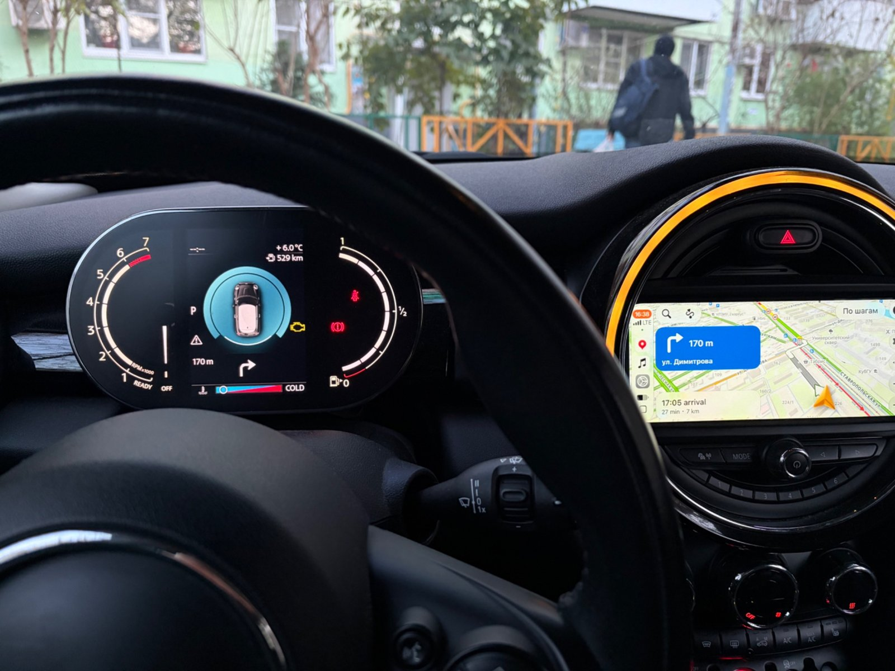
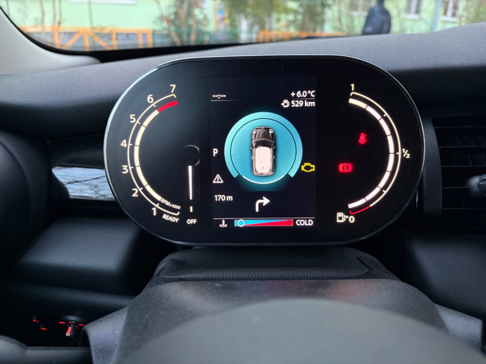
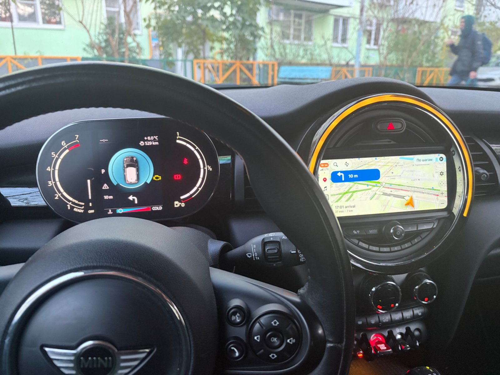

# MINI F5x technical research dossier

**Research snapshot:** 2026-11-25
**Repository:** niz93/nbtevo-carplay-advanced-f5x-6wb-only
**Scope:** CarPlay turn-by-turn guidance on the stock MINI F5x digital instrument panel, while preserving inherited upstream CarPlay Advanced functionality.

## Executive result

The project has progressed beyond source-only experimentation:

- The user confirms that MINI F54, F55, F56, F57 and F60 share the same physical instrument-panel family. This is recorded as **MINI_F5X**. It does not imply identical HMI software, coding, options, terminal instances or MOST behavior.
- A vehicle-tested MINI F54 / HMI 1703 baseline already exists. It includes CarPlay input, HUDTerminal drawing and route-guidance behavior.
- A later MINI F56 vehicle run with DSI **transmissionType 4** produced visible turn guidance on the instrument cluster. The available historical log summary records **HUD: transmissionType 4**, HUDTerminal **82/00**, and maneuver distances of 160 m, 170 m and 10 m. The accompanying user photo shows the 170 m right-turn prompt on both the CarPlay display and the instrument cluster.
- This is **vehicle-observed visible output**, not proof that every DSI request succeeded. The run did not establish a positive F56 ImageGetSize (C04) response, picture-buffer dimensions, a controlled TX=0 comparison or the complete native handle/setup lifecycle.
- The optional selector is implemented as **hud_tx**: default 0, experimental opt-in 4. The DSI **variantTag** remains 1 (eTransmissionTXControl) and **variantValue** remains 0. **transmissionType** is a separate field.
- The current checkout is **not an installable release**. Its prebuilt plugin/librghook-most.so does not match the binary hash recorded for the earlier F56 vehicle test, and this Zenbook currently lacks the LLVM/QNX build toolchain needed to reproduce the payload.

The distinction between visible success and protocol completeness is intentional. No finding below should be promoted to a stronger evidence class than its source supports.

## Terminology and evidence classes

### MINI panel versus BMW 6WB

Use these names consistently:

- **MINI_F5X:** the shared stock MINI instrument-panel family confirmed by the user for F54/F55/F56/F57/F60.
- **BMW 6WB:** a separate BMW F-series multifunction-cluster layout represented by g_6wb in this codebase.
- The phrase “MINI 6WB” in external issue #176 describes a MINI/F5x-labelled surface. It is not a reason to classify the MINI panel as the BMW 6WB layout.

A shared physical panel does not prove that all five chassis use the same HMI build, firmware, coding, terminal instances, transport selector or feature set.

### Evidence classes used in this report

| Class | Meaning |
|---|---|
| USER-CONFIRMED | Explicit vehicle-family or configuration information supplied by the user. |
| VEHICLE-OBSERVED | Captured or photographed on a real vehicle; only the observed behavior is claimed. |
| SOURCE-DERIVED | Established from the checked-in implementation, firmware references or source analysis. |
| HOST-TESTED | Exercised by a host-side test or test double; not a vehicle result. |
| EXTERNAL-REFERENCE | Reported by another repository or contributor; not independently reproduced on this vehicle. |
| UNKNOWN / NOT RUN | Required evidence is absent or the test was not performed. |

## Vehicle photo evidence

| Instrument cluster detail | Left turn in 10 m |
| --- | --- |
|  |  |

Photographs supplied by the project owner from the actual MINI F56 test vehicle. All three photographs retain their full framing and visible street names; the 1600 × 1200 web copies have EXIF metadata removed.

**Evidence boundary:** the photographs confirm matching visible turn direction and distance on the CarPlay center display and MINI instrument cluster, with the vehicle in Park. They do not independently establish DSI packet acknowledgements, ImageGetSize dimensions, the exact tested binary, TX=0/TX=4 causality, or long-term stability. See the [photo provenance and SHA-256 manifest](images/README.md).

## Research inventory and results

### 1. Shared MINI F5x panel family

**Result — USER-CONFIRMED / PARTIAL**

The project treats F54/F55/F56/F57/F60 as one physical instrument-panel family, MINI_F5X. The direct in-car baseline and the later successful route-guidance observation are on F54 and F56 respectively. No direct vehicle test on each of F55, F57 and F60 is claimed.

### 2. F54 in-car baseline and input integration

**Result — VEHICLE-OBSERVED**

The inherited technical record in AGENTS.md records a MINI F54 with HMI ID5_1703-490-1650ZD Build 139:

- 2026-11-11/12: CarPlay full-width output (iPhone 1184 wide, rendered 1180), four knob tilts, held-tilt repeat, rotation and press, touchpad as primary CarPlay input, one- and two-finger gestures, MOST HUD pictures and route guidance, boot hook and recovery links.
- 2026-11-13: settings submenus and persistence, Restart to apply, boot-loop guard, Apple Maps zoom behavior, whole-polygon drawing, and HUD fill/blink behavior using a simulated route.
- The baseline is specific to the F54 / HMI 1703 configuration. It must not be described as a direct test of every F5x chassis.

### 3. iAP2 route-guidance ingestion

**Result — SOURCE-DERIVED / HOST-TESTED**

src/rghook.c is the route-guidance interception and decoding path. The project records iAP2 route-guidance message families including StartRouteGuidanceUpdates (0x5200), RouteGuidanceUpdate (0x5201), ManeuverUpdate (0x5202) and LaneGuidanceInformation (0x5204). The decoded state is made available to the drawing path through the route-guidance/PPS interface and diagnostic logging.

The test inventory includes lane-decoding and reroute/start-marker tests (test_rghook_lanes.py, test_rghook_reroute.py). These are host-side behavioral checks, not proof of every iPhone/application combination.

### 4. MOST / DSI HUDTerminal drawing path

**Result — SOURCE-DERIVED; F54 VEHICLE-OBSERVED**

The MOST client in src/hud.h / src/rghud.cpp registers as a DSI client, discovers the HUDTerminal endpoint and sends StartResultAck drawing calls. The researched function families include:

- 0x204 SetVisibility
- 0x20E SwitchVisibility
- 0x210 SetText
- 0x219 SetLineWidth
- 0x21B SetFillColor
- 0x21D AddPolygon
- 0x220 RemoveAll
- 0xC04 ImageGetSize

The shared MINI panel is represented by HUDTerminal 82/00 in the current source comments. 82/02 is a separate terminal/instance path and must not be assumed to be the same display surface.

### 5. F54 handle discovery and measured geometry

**Result — VEHICLE-OBSERVED on F54**

The F54 native setup record in AGENTS.md describes 22 instance creations and frames 01, 0B and 10. The learned F54 handle map is:

- 1: panel
- 2: unit
- 3: street
- 4: distance
- 5/6: double-buffered maneuver picture
- 0x16: bargraph handle

The F54 C04 ImageGetSize form takes the handle only. The alternate BMW 6WB form with an extra 0x01 byte is rejected on that F54 terminal with an invalid-length ErrorAck.

Measured F54 surface sizes recorded in the inherited vehicle research include:

- 0x01 / 0x10: 408 × 116
- 0x02: 250 × 27
- 0x03 / 0x11: 69 × 24
- 0x04: 33 × 21
- 0x05–0x08, 0x0E, 0x0F: 120 × 72
- 0x09 / 0x0A: 184 × 17
- 0x0B: 227 × 72
- 0x0C: 62 × 22
- 0x0D: 33 × 22
- 0x12: 32 × 21
- 0x13 / 0x14: 250 × 116
- 0x15 / 0x16: 172 × 116
- 0x17: 39 × 39

The MINI picture box is mapped to approximately (35,15)-(85,65) for the 120 × 72 buffer. The F54 terminal does not expose a working distance bar through the tested potentiometer calls. The recorded night palette is route white (4), orange (5), grey (3), with other values documented in AGENTS.md.

### 6. Maneuver and lane geometry

**Result — SOURCE-DERIVED / HOST-TESTED; PARTLY VEHICLE-OBSERVED**

hudshapes.h / hudglyphs.h contain generated Mapbox-style drawings for all 54 iAP2 maneuver types. The implementation includes roundabouts, ferry symbols, left-hand-traffic mirroring, lane drawings and merging of adjacent same-tone convex pieces into fewer whole polygons (up to 96 points per polygon; the cluster accepts up to 99).

The F54 car record confirms that non-convex polygons fill cleanly and that whole-polygon drawing preserved the observed appearance. The first hand-made lane arrows were seen in the car; the newer Mapbox lane drawings are **not yet vehicle-verified**.

### 7. HUD effects

**Result — VEHICLE-OBSERVED IN SIMULATED-ROUTE TESTS**

Fill-toward-turn and blink-near-turn behavior were checked in the F54 with a pretend route. A real route-driven test and daylight palette validation remain open. Do not describe the simulated-route result as a full live-navigation test.

### 8. F56 passive OEM navigation capture

**Result — VEHICLE-OBSERVED / PARTIAL**

The historical capture name is mini-f56-native-nav-20261125-040320-116770.txt. Its recorded 60-second window on HUDTerminal 82/00 contains 215 OEM messages:

- 31 × 0x204
- 167 × 0x21D
- 14 × 0x20E
- 3 × 0x227

The observed handles include 1–8 and 0x16; drawing uses handles 5, 6 and 7. The capture does not include 0x200 CreateInstance, 0x22B FrameAddItem or 0xC04 ImageGetSize in that window. The header's handle map was retained from an earlier start, not learned in the captured 60 seconds. The returned log excludes the 0x210 street-text payloads. This is useful OEM drawing/visibility evidence, not a complete setup or allocator-lifecycle capture.

**Evidence restoration:** the original 15-file capture set and its original manifest were located on both PCs and reverified on Zenbook (15/15 SHA-256 and byte sizes). Raw vehicle logs remain in the local research archive; see [evidence index](EVIDENCE-MANIFEST.json) for public provenance.

### 9. Earlier F56 HUD Probe reports

**Result — VEHICLE-OBSERVED; CAUSE UNKNOWN**

Two of the four historical F56 reports (hud-probe-v1.3.0-20261125-041729-717486.txt and hud-probe-v1.3.0-20261125-042222-571911.txt) each recorded 128 C04 ImageGetSize requests and 128 ErrorAck 0x41 responses across handles 0x01–0x40 and two tested payload forms.

Neither report preserved the DSI transmissionType field. Their visual result was mini: cluster n. The earlier two reports were also checked: each of all four reports contains 128 refused C04 requests (512/512 total). Therefore these reports prove that those particular C04 probes were refused; they do not identify whether TX=0 or TX=4 caused the refusal and do not prove visible rendering.

### 10. Later F56 TX=4 vehicle result

**Result — VEHICLE-OBSERVED VISIBLE GUIDANCE; PROTOCOL COMPLETENESS OPEN**

The later F56 test record from 2026-11-25 reports:

- A 60-second vehicle capture with 26 new log lines.
- The selected log value HUD: transmissionType 4.
- HUDTerminal 82/00.
- Maneuver-distance observations of 160 m, 170 m and 10 m.
- The visible 170 m right-turn prompt is shown in the user photo; the supplementary photo set also shows the 10 m left-turn prompt.
- Seven of seven files in the historical evidence check passed SHA-256 verification.

The tested librghook-most.so was recorded with a SHA-256 prefix d0e448… in the earlier evidence summary. The full evidence archive and full tested-binary hash are not present in this checkout, so the prefix is not a substitute for a reproducible artifact manifest.

The same historical run did **not** provide a positive C04 ImageGetSize response, picture-buffer dimensions or a picture-buffer response trace. A standalone hud_guidance.txt was absent, hud_debug was not enabled, and no controlled TX=0 comparison was performed. Thus the visible F56 result is real, but the reason TX=4 succeeds and the full DSI transaction behavior remain incompletely explained.

### 11. DSI transmissionType selector and C04 response filter

**Result — SOURCE-DERIVED; HOST TESTS PRESENT**

The current source adds the hud_tx setting:

- Valid values: 0 or 4.
- Default: 0 when absent or invalid.
- DSI serialization order: transmissionType, variantTag = 1 (eTransmissionTXControl), variantValue = 0.
- The selector is used for the plugin's MOST HUDTerminal FBlock 0x82 calls, mirror calls and volatile test channel.
- AudioMaster volume calls remain at DSI transmissionType 0.
- The PowerShell and QNX shell installers expose --hud-tx 0|4; the setting is persisted and read at plugin startup.

The C04 reply filter in src/hud.h checks the active transport type, response variant (variantTag = 2, variantValue = 0), source/destination, instance, function and handle before accepting a size reply. The test file test_hud_c04_correlation.py includes ten focused cases.

**Remaining correlation limitation:** the implementation does not claim that the DSI message tag is a proven request transaction ID. A late response with the same TX, endpoint, instance and handle may still be indistinguishable from a response to the current request. The test deliberately verifies that the message tag is not treated as proven correlation.

### 12. External F60 transmissionType evidence

**Result — EXTERNAL-REFERENCE ONLY**

[Sq00ky/Supra-iDrive6-Android-Auto issue #176](https://github.com/Sq00ky/Supra-iDrive6-Android-Auto/issues/176) describes a MINI F60 / NBT Evo ID6 configuration. It reports DSI transmissionType 0 requests rejected with ErrorAck 0x41, while read-only ImageGetSize probing with TX=4 received positive acknowledgements. The response timing was delayed and did not establish that all drawing calls work with TX=4.

The follow-up in that issue says the experimental driver did not complete a live send in its later run because it remained waiting for an observed factory route end. This is a useful transport clue, not a completed F60 drawing validation.

[PR #179](https://github.com/Sq00ky/Supra-iDrive6-Android-Auto/pull/179) is a separate experimental BMW 6WB backend. It is not a MINI F5x implementation and must not be copied or generalized without a source-level comparison and vehicle evidence.

### 13. Ethernet KOMBI path and SIGBUS risk

**Result — HOST-TESTED AGAINST A FAKE KOMBI; VEHICLE STATUS OPEN**

The Ethernet KOMBI path is separate from the MOST path:

- src/kombi.h and src/rgkombi.cpp implement Ethernet KOMBI output.
- The existing host tests exercise protocol framing, reconnects, redraw rules and route output against a fake KOMBI.
- This is not a real-vehicle KOMBI validation.

The current src/rgkombi.cpp still declares static u8 inherit[512] and passes it to spawn() for the sloginfo -w watcher. [st1ng issue #38](https://github.com/st1ng/nbtevo-carplay-advanced/issues/38) reports a SIGBUS risk when the spawn() inheritance structure is not suitably aligned.

build.sh includes rgkombi.cpp in the kombi and both variants, but not in the most variant. The F56 vehicle result used the MOST-only path; src/rghook.c has a separate spawnle() watcher. This narrows the immediate relevance of the specific rgkombi.cpp spawn() risk, but does not close it for KOMBI/BOTH builds. It remains a priority source/build safety issue. Do not enable HUD debug logging on the vehicle as part of this documentation pass.

### 14. Windows installer and build work

**Result — SOURCE-DERIVED; CURRENT BUILD BLOCKED**

The branch includes a Windows PowerShell installer (carplay-advanced.ps1), a Windows build wrapper (build-windows.ps1) and the --hud-tx forwarding/persistence path. The original QNX shell installer remains present.

The Windows build wrapper requires LLVM clang.exe and ld.lld.exe, plus Git Bash. On the current Zenbook session:

- clang.exe and ld.lld.exe were not found.
- Git Bash bash.exe was not found at the paths checked by the wrapper. GitHub Desktop has a bundled sh.exe, but the current wrapper does not select that path.
- ksh is not installed in the current test environment.
- The current full host suite therefore cannot be accepted as passing on this machine.

The repository contains 211 declared test_* methods across its Python test files. The C04 C++ harness and several source-compiled tests require a compiler. The latest local test attempt also exposed a documentation assertion requiring the README to mention transmissionType; this report and README update that omission. Exact post-edit test results are recorded in the cycle report/commit notes, not inferred from the presence of test files.

A previous workcopy reported 71/71 selected Cygwin tests and an ARMv7/QNX build of nine libraries, but that workcopy's full manifests and tested binary are not present in this checkout. Treat those as historical results until the exact artifacts are imported and re-verified here.

## Current Zenbook verification (2026-11-25)

The following checks were run against this local checkout after the documentation updates:

- Python 3.12, tests.test_hud_tx_static + tests.test_builds: 16 tests; **OK**, with 5 skipped (11 executed tests passed).
- C++ / compiler-dependent modules (test_hud_c04_correlation, test_hud_handles, test_hud_init, test_hud_shapes, test_layout): 0 tests executed, 6 skipped because clang/clang++ is unavailable.
- Full discovery: unittest reported 125 tests and FAILED (errors=104, skipped=23). This is not an accepted project test pass. The Windows host cannot launch the POSIX /bin/sh expected by the tests, and the available GitHub Desktop shell bundle is incomplete for the installer test harness.
- POSIX installer tests using the bundled GitHub Desktop sh.exe: 101 tests; 88 failures, 1 error and 1 skipped. The output identifies missing shell utilities including chmod, od and seq, plus Windows /bin/sh path assumptions. These results are environment-blocked and do not establish installer correctness or incorrectness.
- PowerShell parser checks passed for build-windows.ps1 and carplay-advanced.ps1.
- Shell syntax checks passed for build.sh and carplay-advanced.sh using the bundled sh.exe in syntax-only mode.
- The actual ARMv7/QNX build was not run because clang.exe and ld.lld.exe are unavailable.
- All three owner-supplied JPEGs are present in docs/images and their SHA-256 values match the photo manifest.

The earlier README assertion failure for the word transmissionType was corrected; the targeted static test group now passes. Do not turn the skipped or environment-blocked checks into a full acceptance claim.

## Current acceptance matrix

| Area | Current state | What the evidence actually proves |
|---|---|---|
| F54/F55/F56/F57/F60 shared physical panel | USER-CONFIRMED | The user identifies one physical panel family; not five separate vehicle tests. |
| F54 HMI 1703 input and CarPlay baseline | VEHICLE-OBSERVED | The documented F54 in-car behavior on that HMI build. |
| F54 MOST HUDTerminal drawing and geometry | VEHICLE-OBSERVED | The recorded F54 handles, C04 form, surfaces, palette and polygon behavior. |
| F56 passive OEM navigation capture | PARTIAL | OEM drawing/visibility traffic; no complete setup lifecycle in the captured window. |
| F56 pre-TX4 C04 probes | ERROR OBSERVED / CAUSE UNKNOWN | 128/128 ErrorAck 0x41 in each of four reports (512/512); TX field not preserved. |
| F56 visible route guidance with TX=4 | VEHICLE-OBSERVED | Visible 170 m right-turn prompt and historical TX=4 log summary. |
| F56 C04 positive size response / buffer dimensions | UNKNOWN | No positive response or measured dimensions in the available latest run summary. |
| F56 TX=0 versus TX=4 controlled comparison | NOT RUN | No causal A/B result. |
| F55/F57/F60 direct validation | NOT RUN | F60 issue #176 is external evidence only. |
| BMW 6WB layout | SEPARATE PROFILE / NOT VEHICLE-VALIDATED HERE | Do not conflate with MINI_F5X. |
| Mapbox lane glyphs in the car | NOT RUN | Only the earlier hand-made arrows were vehicle-observed. |
| Ethernet KOMBI | HOST-TESTED ONLY | Fake KOMBI tests; no vehicle validation. |
| spawn() alignment / SIGBUS | OPEN RISK | rgkombi.cpp pattern remains present in KOMBI/BOTH source. |
| Current Zenbook ARMv7/QNX build | BLOCKED | Required LLVM/Git Bash toolchain is missing. |
| Full GitHub Issues/PR audit | RECORD-LEVEL COMPLETE; DEEP REVIEW PARTIAL | 362 records classified; 10 issue threads and 9 PR diffs inspected. Original audit manifest recheck 22/23. |

## Remaining research, in priority order

1. **P0 - Finish the existing repository audit.** 362 unique records (250 Issues and 112 PRs) classified; 10 issue discussions and nine PR diffs reviewed. Complete the remaining relevant thread/diff analysis before selecting implementation changes. The source audit manifest currently verifies 22/23 entries; the alignment verification helper has a hash mismatch. Preserve the original manifest and resolve this discrepancy.
2. **P0 - Evidence preservation and restart stability.** The 15 original capture/log files and original manifest are present on the Zenbook research volume, with all sizes and SHA-256 values verified. The latest TX=4 capture metadata and three route logs have been recovered from the conversation and verified against their original SHA-256 listing. Resolve the remaining file gaps; use the existing passive-monitor research and avoid repeating accepted experiments.
3. **P1 - Apply audit findings to the MINI cluster path.** Assess session cleanup, late C04 replies, navigation handover and restart lifecycle in the current source. The exact Issue #38 spawn() path is absent from the installed MOST DSO; keep its alignment risk on the separate KOMBI/BOTH regression track. The audit-only alignment experiment is not an installed fix.
4. **P1 - Clarify C04, response correlation and geometry.** Establish the full native setup/lifecycle and distinguish valid measurement from fallback behavior. An A/B test is optional only if it adds evidence beyond the already observed TX=4 result; any vehicle test requires separate approval.
5. **P2 - Validate text, Unicode, lanes and maneuver updates on MINI_F5X.** Record actual HMI versions and results; distinguish family-level assumptions from vehicle measurements.
6. **P2 - Reproduce the Windows/QNX build and complete regression testing.** Reconcile the exact installed MOST binary with the source and preserve all inherited upstream backends.

The separate HUD terminal 82/02 is outside the no-HUD target scope. Preserve upstream support; no independent HUD experiment or validation gate is required.

## Safety and release boundary

This report-only research pass did not connect to the vehicle, install software, restart the head unit, change firmware, enable HUD debug logging or alter the vehicle's current installation.

Keep hud_tx=0 as the default. TX=4 remains opt-in and experimental even though visible F56 guidance was observed. Do not publish an installable/release claim until the exact tested binary, complete evidence archive, reproducible build, regression suite and recovery procedure are all verified.

## Repository sources used

- AGENTS.md — detailed inherited architecture, F54 in-car baseline, HUDTerminal measurements, input and build constraints.
- src/rghook.c, src/rgview.h — route-guidance interception and state.
- src/hud.h, src/rghud.cpp, src/hudhandles.h, src/hudshapes.h — MOST/DSI client, handle learning, geometry and rendering.
- src/kombi.h, src/rgkombi.cpp — Ethernet KOMBI path.
- carplay-advanced.sh, carplay-advanced.ps1, build.sh, build-windows.ps1 — installer and build paths.
- tests/ — host-side tests, including test_hud_c04_correlation.py and test_hud_tx_static.py.
- External references: [issue #176](https://github.com/Sq00ky/Supra-iDrive6-Android-Auto/issues/176), [PR #179](https://github.com/Sq00ky/Supra-iDrive6-Android-Auto/pull/179), [st1ng issue #38](https://github.com/st1ng/nbtevo-carplay-advanced/issues/38).
