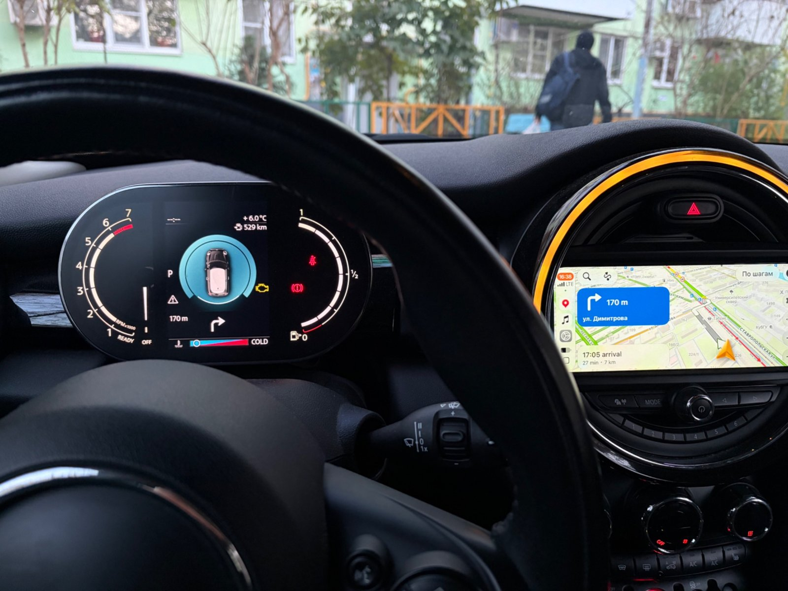
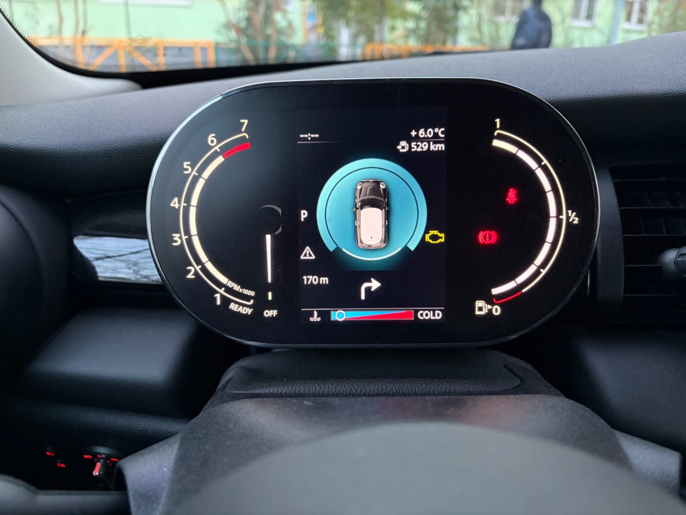
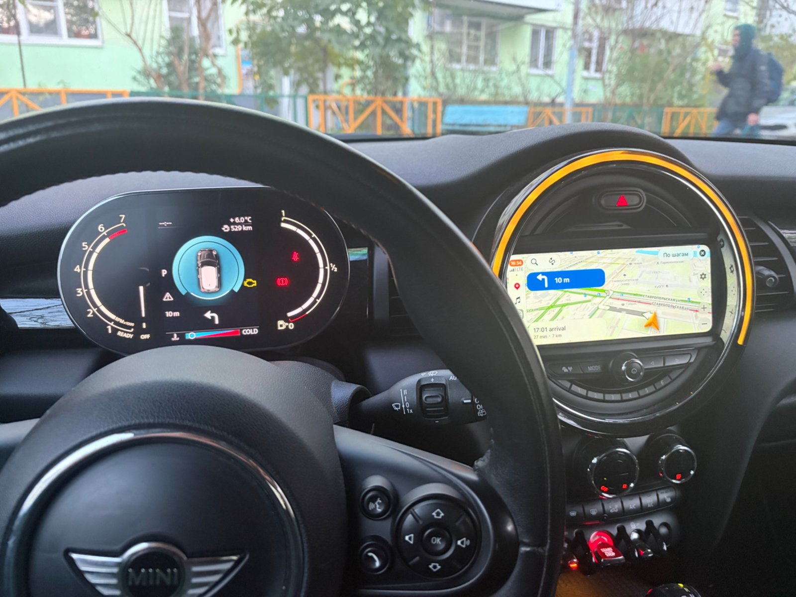

# MINI F5x vehicle test photographs

The following photographs were supplied by the project owner and authorized for publication. They show actual in-car results on the MINI F56 test vehicle. No stock, generated or third-party imagery is used in this photo set. The web copies preserve the full scene (including street names) at 1600 × 1200; EXIF metadata was removed.

| Original filename | Repository JPEG | SHA-256 |
| --- | --- | --- |
| IMG_8254.jpeg | [mini-f5x-right-turn-170m.jpg](mini-f5x-right-turn-170m.jpg) | 4711d012a1988e017c59ffc9759f0516ea04f1858f2a01ad89d5e10c5c7e6953 |
| IMG_8255.jpeg | [mini-f5x-cluster-detail.jpg](mini-f5x-cluster-detail.jpg) | f4fd32ca5cb7cd29dd39fd1a457d7057bf3f4ba37b2bf7b526eb25c3f54cb31d |
| IMG_8253.jpeg | [mini-f5x-left-turn-10m.jpg](mini-f5x-left-turn-10m.jpg) | 99099a8503650d06acc73627fd2e8f2a1ed5a9791802d81b412f4bea02ad8e70 |

## Gallery

| Instrument cluster detail | Left turn in 10 m |
| --- | --- |
|  |  |

Photographs supplied by the project owner from the actual MINI F56 test vehicle. All three photographs retain their full framing and visible street names; the 1600 × 1200 web copies have EXIF metadata removed.

## Evidence boundary

The photographs show matching direction and distance on the center display and digital instrument cluster. They do not independently prove the DSI transport setting, binary identity, C04 ImageGetSize results, buffer dimensions, complete handle lifecycle, causal TX=0/TX=4 comparison or stability across vehicles.

See the [technical research dossier](../MINI_F5X_TECHNICAL_RESEARCH.md).
